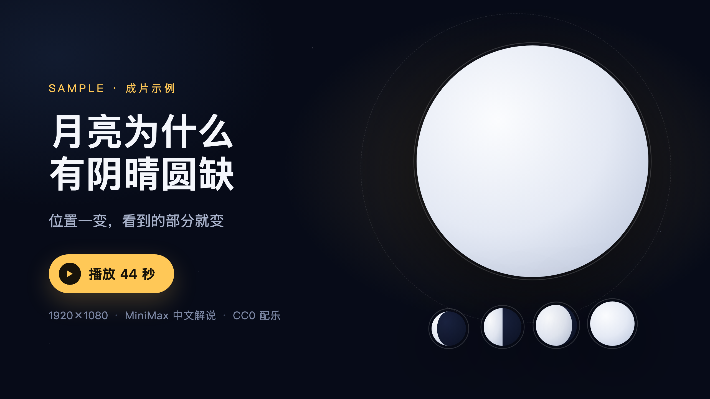

# science-video

一个 WorkBuddy / Claude 风格的 Skill：**用代码画科普动画短片**。给一个题目，产出一条 45 秒左右的横屏 mp4 —— 有中文解说、逐句字幕、CC0 背景音乐，画面全部由 SVG 和帧号算出来，不用任何外部图片素材。

作者微信：**staraiwork**（用的时候卡住了可以直接找我）

## 先看成片

下面这条是用本 Skill 做的示例《月亮为什么有阴晴圆缺》，六屏高光剪在一起（GIF 自动循环）：


[](examples/moon/moon.mp4)

> 完整版 44 秒、1920×1080、30fps、约 5.5 MB，MiniMax 中文解说 + CC0 配乐，成片响度 -16.7 LUFS。
> **点封面**在 GitHub 里直接播放；也可以下载 [`examples/moon/moon.mp4`](examples/moon/moon.mp4)。

## 工作原理一图看懂


> 矢量版 `assets/diagram/工作原理.svg`，可直接拖进 PPT / Keynote 编辑；`工作原理.html` 是源文件。

## 一、它怎么工作

```
题目 ──▶ 写分镜（等用户确认）──▶ 铺 Remotion 项目 ──▶ MiniMax 配音、量出真实时长
                                                        │
   成片 mp4 ◀── 渲染 ◀── 逐屏写画面、逐屏截图检查 ◀──────┘
```

关键设计：**先配音，再定时长**。每屏帧数 = 这段解说的实际长度 + 0.8 秒，画面里所有动画节点写成「总长 - 常数」，所以改一句解说词，整套节奏自动跟着变，不用手调帧号。字幕也按字数比例分配时间，一句一条贴着语音走。

## 二、要配置什么

| 依赖 | 必须？ | 说明 |
|---|---|---|
| Node.js ≥ 18 | 必须 | Remotion 跑在 Node 上，去 https://nodejs.org 装 LTS |
| ffmpeg / ffprobe | 必须 | 用来量配音长度、查成片响度 |
| MiniMax API Key | 要解说就必填 | 在 https://platform.minimaxi.com 申请，**账户里要有余额**，没钱会返回 `insufficient balance` |
| Chrome | 可选 | 渲染时若下载 Chromium 失败，用它本机的 Chrome 顶上 |
| 背景音乐 | 不用配 | 自带 `assets/bgm.mp3`（Outer Space Loop / wipics / CC0，可商用），想换就替换同名文件 |

Key 只放在项目根目录 `.env` 里，格式 `MINIMAX_API_KEY=sk-xxx`；也支持环境变量 `export MINIMAX_API_KEY=sk-xxx`。脚本不会把 Key 打到日志里。

## 三、安装

```bash
git clone https://github.com/seeyouintokyo/science-video-skill.git
cp -R science-video-skill ~/.workbuddy/skills/science-video
```

项目级安装就放到 `<项目>/.workbuddy/skills/science-video`。

## 四、用法

在 WorkBuddy 里直接说：

```
用 science-video 做一条科普视频：
题目：彩虹是怎么形成的
45 秒，横屏，用 MiniMax 配中文解说。
先给我看分镜。
```

它会先出 `分镜.md`（六屏，每屏带解说词），你说「可以」之后才开始铺项目、配音、写画面、渲染。成片在项目 `out/video.mp4`。

命令行单独跑：

```bash
node scripts/scaffold.mjs my-video     # 铺一个空项目
cd my-video && npm install --registry=https://registry.npmmirror.com
# 改 src/narration.json
node tools/tts.mjs                     # 合成 voice/s1..s6.mp3，回写 src/voice.json
npx remotion render src/index.ts Main out/video.mp4
```

## 五、目录结构

```
science-video-skill/
├── SKILL.md                       # 给 AI 读的作业流程和硬规则
├── scripts/
│   ├── scaffold.mjs               # 一键铺出可运行的 Remotion 项目
│   └── tts.mjs                    # MiniMax 配音 + 时长回写
├── assets/
│   ├── tokens.ts                  # 配色、字号、间距、动画节奏（换风格只改这个）
│   ├── bgm.mp3                    # CC0 背景音乐
│   ├── preview/                   # README 用的动图、封面、静帧
│   └── scaffold/                  # 项目骨架：组件、占位屏、Video 装配
├── references/
│   └── remotion-recipes.md        # 月相、轨道、平行光束、分屏、字幕时间分配的画法
└── examples/moon/                 # 已完成的月相短片：成片 mp4 + 分镜 + 全部源码
```

`examples/moon` 是可以直接对照的完整答案：成片 `moon.mp4`、六个 screen 组件、`narration.json`、`voice.json`、`分镜.md` 都在里面。

## 六、几个常见坑

1. **`npm install` 太慢**：加 `--registry=https://registry.npmmirror.com`。
2. **渲染报下载浏览器失败**：命令后加 `--browser-executable="/Applications/Google Chrome.app/Contents/MacOS/Google Chrome"`（Windows 换成 `C:\Program Files\Google\Chrome\Application\chrome.exe`）。
3. **中文变方块**：字体必须走 `tokens.font.family`，不要引网络字体。
4. **配音报模型不存在**：`.env` 里加一行 `MINIMAX_TTS_MODEL=speech-2.6-hd`。
5. **想换女声**：`.env` 里 `MINIMAX_VOICE=presenter_female`，重跑 `node tools/tts.mjs`。
6. **成片声音偏小**：抬 `src/Video.tsx` 的 `VOICE_GAIN` / `BGM_GAIN`，目标是 -16 LUFS、峰值不超 -1.5 dBFS。

## 七、许可

代码 MIT。自带音乐是 CC0（公共领域，可商用，无需署名），来源见 `assets/bgm.mp3` 对应说明：Outer Space Loop by wipics, https://opengameart.org/content/outer-space-loop。

用的时候出问题，微信找我：**staraiwork**。
